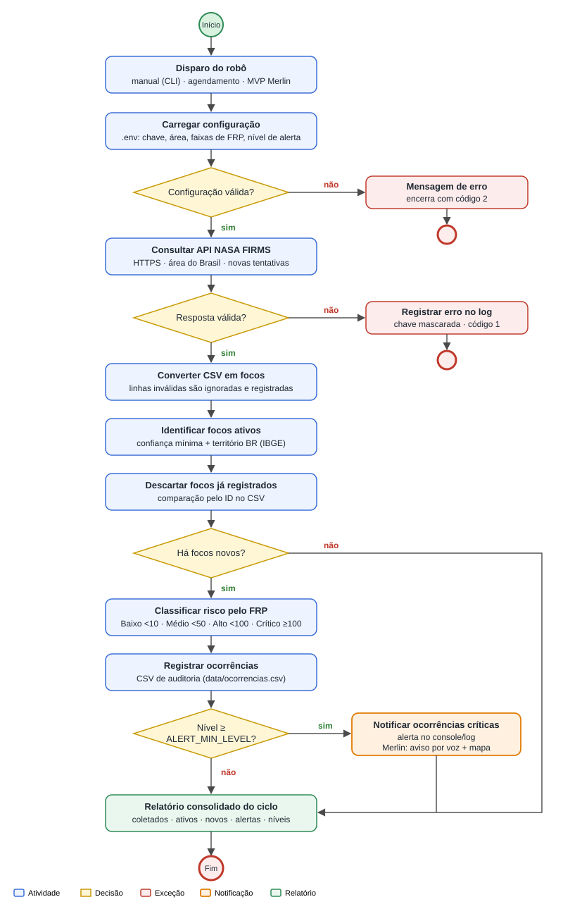

# FIRMS Monitor – Monitoramento Automatizado de Incêndios com Dados da NASA FIRMS

Global Solution · Robotic Process Automation (RPA) · FIAP · Turma 4ESPY

Robô em Python que consome a API **NASA FIRMS**, identifica focos de incêndio ativos no Brasil,
classifica o risco pelo **FRP (Fire Radiative Power)**, registra as ocorrências em CSV, notifica
automaticamente as ocorrências críticas e gera um relatório consolidado ao fim de cada ciclo.
O robô é integrado ao **MVP Merlin**, um assistente de voz que fala o alerta e direciona o usuário
para um mapa com os focos de calor.


## Estrutura do repositório

| Pasta / arquivo | Conteúdo |
|---|---|
| `src/firms_monitor/` | Código-fonte Python do robô |
| `docs/` | Fluxograma do processo (`fluxograma.svg`) e fonte do relatório técnico |
| `assets/` | Imagens e evidências visuais das execuções |
| `logs/` | Amostras de logs gerados, sem dados sensíveis |
| `tests/` | Testes automatizados, instruções e evidências dos testes realizados |
| `main.py` | Atalho para executar o robô |
| `pyproject.toml` | Build do pacote instalável via `pip` |
| `.env.example` | Modelo de configuração (sem chaves) |

`power-automate/` não se aplica: a automação é implementada inteiramente em Python.

## Fluxo



```
FIRMS API ──► Filtros (confiança + território BR) ──► Deduplicação ──► Classificação por FRP
                                                                          │
                                                CSV (registro) ◄──────────┤
                                                Alertas (console/log, Merlin) ◄── nível ≥ ALERT_MIN_LEVEL
                                                Relatório consolidado do ciclo
```

## Regras de risco (padrão, configuráveis)

| Nível   | FRP (MW)    |
|---------|-------------|
| Baixo   | < 10        |
| Médio   | 10 – < 50   |
| Alto    | 50 – < 100  |
| Crítico | ≥ 100       |

- Foco **ativo** = detecção que não seja de baixa confiança (VIIRS `l`; MODIS < `MIN_NUMERIC_CONFIDENCE`) e que esteja dentro do território brasileiro.
- O alerta é disparado para focos com nível ≥ `ALERT_MIN_LEVEL` (padrão `CRITICO`; use `ALTO` para ser avisado também de focos altos).
- Somente focos **novos** são registrados e alertados — um foco já presente no CSV não gera alerta novamente.

## Área monitorada

A consulta é feita por **área (bounding box)** via `/api/area`, pois o endpoint por país (`/api/country`)
foi descontinuado pela NASA. O padrão é o retângulo que envolve o Brasil:

```env
FIRMS_QUERY_MODE=area
FIRMS_BBOX=-74.0,-34.0,-34.7,5.3   # oeste,sul,leste,norte
```

Como o retângulo também cobre países vizinhos, os focos passam por um **filtro de território**
que mantém apenas os que estão dentro do contorno oficial do Brasil (malha do IBGE, embutida no pacote):

```env
TERRITORY_FILTER=BR                    # padrão: só Brasil
TERRITORY_FILTER=C:\mapas\area.geojson # contorno próprio (Polygon/MultiPolygon)
TERRITORY_FILTER=                      # desligado
```

Focos fora do território não são gravados nem alertados. O contorno não inclui ilhas oceânicas
(Fernando de Noronha, Trindade), que já ficam fora do `FIRMS_BBOX` padrão.

> No resumo do ciclo, **Coletados** é o total devolvido pela NASA (inclui vizinhos);
> **Ativos** é o que sobrou após os filtros — esse é o número do Brasil.

## Arquitetura

```
src/firms_monitor/
├── domain/                 # Regras de negócio puras (sem I/O)
│   ├── models.py           # FireHotspot, ClassifiedHotspot, RiskLevel
│   ├── risk.py             # RiskRule, RiskClassifier
│   ├── filters.py          # ConfidenceFilter, MinFrpFilter, TerritoryFilter, CompositeFilter
│   └── territory.py        # Polygon, Territory (ponto dentro do polígono, sem dependências)
├── application/            # Casos de uso
│   ├── ports.py            # Interfaces: HotspotProvider, OccurrenceRepository, AlertNotifier
│   ├── monitor.py          # FireMonitorService (orquestração) + ExecutionReport
│   └── runner.py           # PeriodicRunner (execução em loop, resiliente a falhas)
├── infrastructure/         # Adaptadores concretos
│   ├── firms/              # queries.py, client.py (HTTP + retry), parser.py (CSV), provider.py
│   ├── geo/                # GeoJsonTerritoryLoader (lê contornos GeoJSON)
│   ├── persistence/        # CsvOccurrenceRepository (com migração automática de formato)
│   └── notification/       # LogAlertNotifier, CompositeNotifier
├── data/brasil.geojson     # Contorno do Brasil (IBGE), embutido no pacote
├── presentation/
│   └── console_formatter.py # Console visual: cores, selos de risco, banner de alerta, resumo em caixa
├── config.py               # Settings (variáveis de ambiente / .env)
├── logging_config.py       # Log em console (visual) + arquivo rotativo (texto puro)
├── bootstrap.py            # Composition root (injeção de dependências)
├── cli.py                  # Linha de comando (comando firms-monitor)
└── __main__.py             # Permite python -m firms_monitor
```

Cada classe tem responsabilidade única e a camada de aplicação depende apenas de **interfaces**
(`typing.Protocol`), então trocar CSV por banco ou log por outro canal não exige mexer no caso de uso.

## Instalação

```bash
python -m venv .venv
.venv\Scripts\activate
pip install -r requirements.txt
copy .env.example .env      # preencha FIRMS_MAP_KEY
```

MAP_KEY gratuita: https://firms.modaps.eosdis.nasa.gov/api/map_key/

## Uso

```bash
python main.py                        # executa um ciclo e encerra
python main.py --interval-minutes 30  # modo contínuo (Ctrl+C para parar)
python main.py --env-file outro.env   # usa outro arquivo de configuração
```

Com o pacote instalado, `firms-monitor` ou `python -m firms_monitor` são equivalentes a `python main.py`.

- Cada ciclo leva poucos segundos e consulta o período de `FIRMS_DAY_RANGE` (1 a 5 dias, padrão 1 = dia atual em UTC).
- Intervalo recomendado: **30 a 60 minutos** — os dados NRT chegam à API cerca de 3h após a passagem do satélite.
  A passagem da tarde (~13h–15h em Brasília) concentra os focos mais intensos.
- Para rodar sem terminal aberto, agende `python main.py` no Agendador de Tarefas do Windows (ou cron).

Códigos de saída: `0` sucesso · `1` erro na API FIRMS ou no arquivo de registro · `2` configuração inválida.

### Console

O console mostra cores, selo colorido por nível de risco, banner de alerta e um resumo do ciclo
com gráfico de barras por nível. As cores são detectadas automaticamente; use `NO_COLOR=1` para
desligar ou `FORCE_COLOR=1` para forçar. O arquivo de log não é afetado (texto puro).

### Saídas

| Arquivo                   | Conteúdo                                              |
|---------------------------|-------------------------------------------------------|
| `data/ocorrencias.csv`    | Ocorrências processadas (somente do território), sem duplicatas |
| `logs/firms_monitor.log`  | Log de execução, alertas (`WARNING`) e relatório consolidado de cada ciclo |

Amostras de log sem dados sensíveis estão em [`logs/`](logs/).

### Colunas do CSV

| Coluna | Conteúdo |
|---|---|
| `id` | Identificador único do foco (usado para não registrar/alertar duas vezes) |
| `processado_em_utc` / `detectado_em_utc` | Quando o robô gravou / quando o satélite detectou |
| `latitude` / `longitude` | Posição do foco |
| `frp_mw` / `nivel_risco` | Potência radiativa (MW) e nível de risco calculado |
| `confianca` / `satelite` / `instrumento` / `dia_noite` | Dados da detecção |
| `brilho_k` | Temperatura de brilho (K) |
| `pais` / `fonte` / `mapa` | País (quando informado), fonte FIRMS e link do Google Maps |
| `scan_km` / `track_km` | Tamanho do pixel do satélite (largura × altura, em km) |

- O arquivo é criado automaticamente. Para recomeçar do zero, **apague** o arquivo (um arquivo esvaziado também é tratado).
- Se o CSV estiver em um formato antigo (sem colunas novas), ele é **migrado automaticamente**: as colunas
  são acrescentadas e as linhas antigas ficam com esses campos vazios. A reescrita é atômica (arquivo temporário).
- Arquivos sem cabeçalho ou com colunas desconhecidas não são alterados: o robô para com uma mensagem de erro.

## Configuração (`.env`)

| Variável                  | Padrão                  | Descrição                                    |
|---------------------------|-------------------------|----------------------------------------------|
| `FIRMS_MAP_KEY`           | —                       | Chave da API (obrigatória)                   |
| `FIRMS_SOURCE`            | `VIIRS_NOAA20_NRT`      | Sensor/satélite (ex.: `MODIS_NRT`)           |
| `FIRMS_QUERY_MODE`        | `area`                  | `area` (recomendado) ou `country`            |
| `FIRMS_BBOX`              | `-74.0,-34.0,-34.7,5.3` | Área consultada na NASA (oeste,sul,leste,norte) |
| `FIRMS_DAY_RANGE`         | `1`                     | Dias retroativos (1 a 5)                     |
| `RISK_MEDIO_FRP` / `RISK_ALTO_FRP` / `RISK_CRITICO_FRP` | `10` / `50` / `100` | Faixas de risco em MW |
| `ALERT_MIN_LEVEL`         | `CRITICO`               | `BAIXO`, `MEDIO`, `ALTO` ou `CRITICO`        |
| `MIN_NUMERIC_CONFIDENCE`  | `30`                    | Confiança mínima (sensores numéricos/MODIS)  |
| `MIN_FRP`                 | `0`                     | FRP mínimo para considerar o foco            |
| `TERRITORY_FILTER`        | `BR`                    | Território aceito (`BR`, caminho GeoJSON ou vazio) |
| `OUTPUT_CSV`              | `data/ocorrencias.csv`  | Arquivo de registro (relativo à pasta de execução) |
| `LOG_FILE` / `LOG_LEVEL`  | `logs/firms_monitor.log` / `INFO` | Log                                |

## Testes

```bash
pip install -r requirements-dev.txt
python -m pytest -v
```

57 testes automatizados (sucesso, decisão e falha) e evidências das execuções reais em [`tests/`](tests/).

## Integração com o MVP Merlin

O robô é integrado ao **Merlin**, um assistente de voz: ao receber um alerta de foco de risco elevado,
o Merlin fala o aviso e direciona o usuário para uma visualização em mapa com os focos de calor.

O projeto foi preparado com um build para ser instalado via `pip` no **MVP Merlin**:

```bash
pip install -e D:\document\RPA-GS                 # desenvolvimento: alterações aqui refletem lá
pip install git+<link do repositório>             # a partir do repositório
```

O pacote contém apenas o código de `src/firms_monitor/`  O `.env` e as
pastas `data/` e `logs/` **não** são incluídos — cada projeto que usa o pacote tem seus próprios dados.

### Compartilhando uma versão fixa (`.whl`)

```bash
pip wheel D:\document\RPA-GS --no-deps -w vendor   # gera vendor/firms_monitor-<versão>-py3-none-any.whl
```

E no `requirements.txt` do outro projeto: `./vendor/firms_monitor-<versão>-py3-none-any.whl`.
Antes de gerar, atualize a versão em `pyproject.toml` e `src/firms_monitor/__init__.py`.

## Segurança e LGPD

- O robô processa apenas dados públicos de satélite (coordenadas, horário e intensidade de focos de calor); **não coleta dados pessoais**.
- A chave da API fica no `.env`, que não é versionado, e aparece sempre mascarada (`***`) em logs e mensagens de erro.
- As amostras de log e as evidências do repositório não contêm chaves nem caminhos pessoais.
- Toda comunicação com a NASA FIRMS é feita por HTTPS.

## Versões

| Versão | Mudanças |
|---|---|
| 1.2.0 | Tamanho do pixel (`scan_km`, `track_km`) lido da FIRMS e gravado no CSV; migração automática de CSVs antigos |
| 1.1.0 | Filtro de território brasileiro (contorno IBGE embutido) |
| 1.0.0 | Versão inicial: coleta FIRMS, classificação por FRP, CSV, alertas, console visual, pacote instalável |
